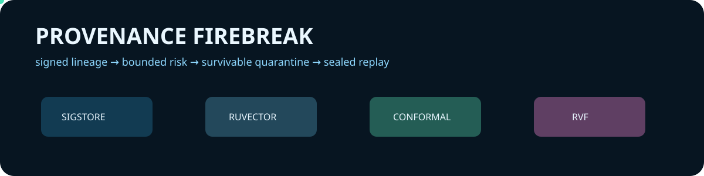
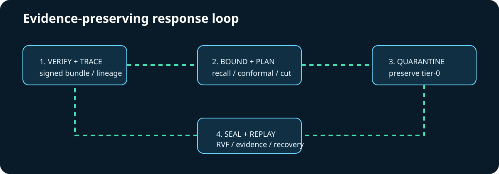

# Provenance Firebreak



A signed-software supply-chain incident response system that reconstructs temporal deployment lineage, recalls analogous incidents with RuVector, bounds risk with split conformal calibration, chooses a least-disruptive quarantine preserving tier-0 services, and seals replay evidence with RVF.

## Quickstart

```bash
cargo run --locked -p pf-cli -- --input fixtures/incident.json --state target/demo
```

The JSON result reports the conformal upper risk, analogue count, exact quarantine set, append-only evidence receipt, and recovery verification. Invalid Sigstore structures fail closed; a structurally valid but untrusted fixture proves the real verification-rejection boundary.

## Workspace and composition

The 22-crate workspace map is in [architecture](docs/architecture.md). The exact upstream pins, interfaces, tests, and ablations are in the [integration matrix](docs/integration-matrix.md).

| Ingredient | Executed responsibility | Ablation |
|---|---|---|
| RuVector 2.4.0 | durable vector insert/search for incident analogues | analogous recall becomes false |
| RVF crypto 0.2.0 | witness-chain sealing and verification | evidence becomes unverifiable |
| Sigstore Rust 0.14.0 | bundle deserialization and trust rejection | provenance policy becomes unsafe |
| Split conformal | finite-sample upper risk gate | calibrated bound disappears |



## Validation and maturity

Run `cargo fmt --check`, strict Clippy, `cargo test --locked`, `cargo deny check`, and `bash scripts/run-evaluation.sh`. This is an experimental incident-planning system: the checked-in fixture intentionally has no trusted production key; it proves parsing and fail-closed verification, not a live production identity. See [specification](docs/specification.md), [ADRs](docs/adrs/README.md), [DDD](docs/ddd/README.md), [research](docs/research.md), and [validation](docs/design/validation.md).
